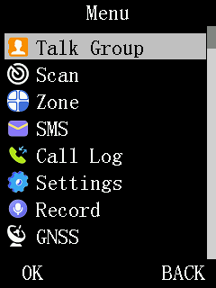

# dm32uv-qemu

[](https://github.com/awkaplan/dm32uv-qemu/actions/workflows/build.yml)

A QEMU board model (`-M dm32`) for the **Baofeng DM-32UV**, a DMR/analog handheld radio built on
the HR_C7000 SoC (C-SKY CK803S core). It runs the radio's stock firmware and
[OpenRTX](https://github.com/OpenRTX/OpenRTX) builds: the firmware boots, reads its codeplug (the
radio's channel and settings database) from an emulated SPI-NOR data chip, draws its user interface
on an emulated LCD, and takes scripted key presses.


<p align="center">
  
</p>

Every screen above is the emulated LCD's own frame buffer, captured with `DM32_GRAMDUMP` and
rendered by [`scripts/gram2png.py`](scripts/README.md); see
[docs/images/README.md](docs/images/README.md) for how they were made.

It is packaged as a **source-only overlay**: files and one small patch that you install into a QEMU
checkout, not a fork of QEMU. It sits on top of
[csky-qemu](https://github.com/awkaplan/csky-qemu), which provides the C-SKY CPU target. The
device models were written from the HR_C7000 and FD6818 datasheets and from the stock firmware's
own register traffic.

This repository contains no firmware. Firmware images, the patches the stock image needs under
emulation, and the test harness live in [dm32uv-re](https://github.com/awkaplan/dm32uv-re). Paths
in these documents such as `data/registers/HR_C7000-DM32.svd` or `tools/src/dm32_patch_tools/` are
in dm32uv-re unless they name a file in this repository.

## Status

Works, with stock firmware DM32.00.01.048 (plus dm32uv-re's emulator-only patches) and OpenRTX:
- Boot to the standby screen, menu navigation and scripted key presses, including dm32uv-re's Snake
  example patch (a game added to the stock menu) run end to end. The stock regression runs touch no
  unmapped or unimplemented address.
- Interrupts and the RTOS tick, the real-time clock, the data chip (reads, program and erase, with
  optional write-back to a file), the ADC, DAC, PWM (PWM0 is the backlight) and watchdog.
- The LCD, shown on a QEMU console (VNC) and dumpable as raw frames once the screen settles.
- Register-level models of the FD6818 RF transceiver, with a scripted RF environment
  (`DM32_RF_ENV`) that drives its RSSI, squelch and CTCSS/CDCSS detection, and of the DMR Layer-2
  slot timing.

Not modelled:
- The ALPU-MP anti-clone chip, an authentication chip the stock firmware checks at boot, on a
  bit-banged (software-driven) I2C bus on GPIOA 5 and 6. Stock firmware halts at IRAM `0x169d4`
  unless its check is patched out (dm32uv-re's `compose_qemu_image.py` does this).
- Any RF or audio signal path: no transmitter, receiver, vocoder or modem data path. The DMR
  baseband RAM is captured, not decoded.
- USB and SDIO, which log their accesses only.

Each device's coverage, grade and known gaps are in [docs/coverage.md](docs/coverage.md).

## Quick start

```sh
git clone https://gitlab.com/qemu-project/qemu.git
git clone https://github.com/awkaplan/csky-qemu.git
git clone https://github.com/awkaplan/dm32uv-qemu.git
git -C qemu checkout "$(cat dm32uv-qemu/QEMU_COMMIT)"           # the tested QEMU commit
git -C csky-qemu checkout "$(cat dm32uv-qemu/CSKY_QEMU_COMMIT)" # the tested csky-qemu commit
csky-qemu/install.sh qemu
dm32uv-qemu/install.sh qemu
cd qemu
./configure --target-list=cskyv2-softmmu
ninja -C build qemu-system-cskyv2
./build/qemu-system-cskyv2 -M help    # lists dm32
```

`install.sh` copies this repository's `hw/` and `include/` trees into the checkout and applies
[`integration/top-level.diff`](integration/top-level.diff), which registers the device files with
QEMU's build. It is safe to run again. QEMU's own build dependencies apply (see the
[QEMU build documentation](https://www.qemu.org/docs/master/devel/build-environment.html)).

Then boot a firmware image:

```sh
./build/qemu-system-cskyv2 -M dm32 -cpu ck803 -L pc-bios -vnc 127.0.0.1:0 -serial stdio \
    -kernel firmware.bin \
    -device loader,file=IRAM.bin,addr=0x00010000
```

and connect a VNC client to port 5900. [docs/running.md](docs/running.md) explains every input
(including where the IRAM image and a codeplug image come from), frame capture and debugging. For
day-to-day use with stock firmware, dm32uv-re's `qemu_run.py` builds this command line for you.

## Testing

```sh
tests/run-smoke.sh qemu/build/qemu-system-cskyv2   # boots a small image on -M dm32
tests/run-qtest.sh qemu/build/qemu-system-cskyv2   # register-level device tests, no firmware
tests/run-svd-tests.sh                             # SVD table generator and register file
tests/checkpatch.sh qemu                           # QEMU's style checker, with an allowlist
```

The smoke test ([`tests/smoke/smoke.S`](tests/smoke/smoke.S)) checks arithmetic, SRAM and three
device registers, then prints `dm32uv-qemu smoke test: PASS` on UART0. The prebuilt `smoke.bin` is
committed so no C-SKY toolchain is needed. The register-level tests in
[`tests/qtest/`](tests/qtest/README.md) drive each device model under `-accel qtest`. CI runs all
of them on every push ([`.github/workflows/build.yml`](.github/workflows/build.yml)).

The real regression is the stock firmware: booting to standby and walking through the Snake
example, using dm32uv-re's harness. See [CONTRIBUTING.md](CONTRIBUTING.md#building-and-testing).

## Documentation

| Document | Contents |
|---|---|
| [docs/running.md](docs/running.md) | inputs, command lines, display, frame capture, debugging |
| [docs/environment.md](docs/environment.md) | every `DM32_*` environment variable (logging, injection, data-chip files) |
| [docs/devices.md](docs/devices.md) | memory map and every device model |
| [docs/coverage.md](docs/coverage.md) | how complete and how faithful each model is; known gaps; roadmap |
| [docs/coverage-plan.md](docs/coverage-plan.md) | the item-by-item plan behind the roadmap; open items to pick up |
| [docs/boot-path.md](docs/boot-path.md) | what stock firmware needs from the board, in boot order; debugging a stuck boot |
| [docs/key-injection.md](docs/key-injection.md) | scripted keypad, knob and PTT input |
| [docs/modem-timing.md](docs/modem-timing.md) | the DMR Layer-2 slot-timing model |
| [docs/boot-rom.md](docs/boot-rom.md) | the SoC's mask boot ROM, and why the model skips it |
| [docs/port-notes.md](docs/port-notes.md) | QEMU API changes met porting the model to current QEMU |

## Repository layout

The source trees mirror QEMU's own layout, so every file lands at the same path in the checkout.

```
hw/csky/dm32.c                the -M dm32 machine: memory map, wiring, reset entry, DM32_* helpers
hw/csky/Kconfig, meson.build  csky-qemu's files with the dm32 machine added
hw/display/dm32_lcd.c         LCD controller (ST7789V-class, 8080 bus), 240x320
hw/gpio/dm32_gpio.c           GPIO banks: boot pins, keypad, pin injection, interrupts
hw/intc/dm32_pic.c            interrupt controller
hw/timer/dm32_timer.c         timers (DesignWare APB timer), RTOS tick
hw/misc/dm32_sysreg.c         system and clock registers, pad mux, DMR slot timing
hw/misc/dm32_ssi.c            SPI masters and the 16 MB W25Q128 data chip
hw/misc/dm32_spi_slave.c      SPI slave ports (no master on the board)
hw/misc/dm32_adc.c            ADC
hw/misc/dm32_dac.c            DAC
hw/misc/dm32_pwm.c            PWM (backlight)
hw/misc/dm32_wdt.c            watchdog
hw/misc/dm32_i2c.c            I2C masters; dm32_i2c_rtc.c, the real-time clock on I2C2
hw/misc/dm32_fd6818.c         FD6818B RF transceiver and RF environment
hw/misc/dm32_rda5807m.c       RDA5807M FM tuner registers, on the bit-banged fm bus
hw/misc/dm32_dmrram.c         DMR baseband RAM window (capture only)
hw/misc/dm32_codec.c          audio codec registers, over the DMR RAM window
hw/misc/dm32_cache.c          cache controller registers
include/hw/csky/dm32.h        functions the devices call in each other, shared helpers
include/hw/csky/dm32_svd.h    register tables generated from dm32uv-re's SVD (do not edit)
include/hw/csky/dm32_regfile.h  register file that applies those tables
integration/top-level.diff    the patch to QEMU's build files
install.sh                    installs everything into a QEMU checkout
QEMU_COMMIT, CSKY_QEMU_COMMIT the commits this is tested against
scripts/                      framebuffer, data-chip and SVD-table helpers (Python, stdlib only)
tests/smoke/                  a tiny bootable image and its runner, run-smoke.sh
tests/qtest/                  register-level device tests, run-qtest.sh
tests/svd/                    SVD generator and register-file tests, run-svd-tests.sh
tests/                        also checkpatch.sh (QEMU style) and objhash.py (behaviour-neutral proof)
docs/                         the documentation above; docs/images/, the README screenshots
```

## Contributing

See [CONTRIBUTING.md](CONTRIBUTING.md). AI coding tools should also read [AGENTS.md](AGENTS.md).

## Safety

Nothing in this repository writes to a radio. Images composed for emulation (with the ALPU check
patched out, or with a data chip built from your own radio's dump) must never be flashed to
hardware. A radio's calibration data is specific to that unit; keep a verified backup of your own
before experimenting, and never share or reuse another unit's.

## License

[PolyForm Noncommercial 1.0.0](LICENSE.md), the same terms as
[dm32uv-re](https://github.com/awkaplan/dm32uv-re); each file carries an `SPDX-License-Identifier`
line. Two build files derived from csky-qemu stay LGPL-2.1-or-later. Because QEMU is GPL-2.0, build
the overlay from source and do not distribute binaries that include it; see
[LICENSE.md](LICENSE.md). Baofeng and DM-32UV are trademarks of their owners; this project is not affiliated
with Baofeng.
